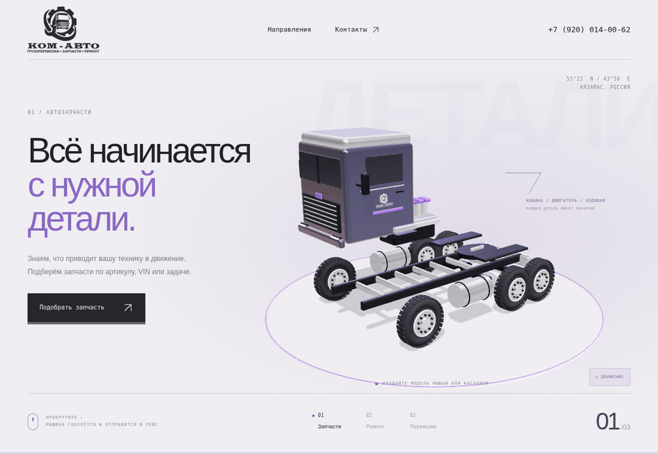

# КОМ-АВТО — новая версия сайта

Отдельный прототип для оценки владельцем и мастером. Рабочий kom-avto.ru не изменяется.



Текущая главная — интерактивная концепция «Большое начинается с деталей». Стилизованный грузовик, созданный из геометрии Three.js, меняется при прокрутке: собранная машина → разборка на узлы → колесо для раздела сервиса → схема маршрута. Это демонстрационная модель, не точная инженерная копия конкретной марки. Используется настоящий логотип КОМ-АВТО с подписью «Грузоперевозки · Запчасти · Ремонт»: исходные PNG с действующего сайта сохранены без изменения в `public/images/logo-white.png` и `logo-dark.png`. Знак размещён также на кабине модели.

Модель вращается перетаскиванием и стрелками клавиатуры; вертикальная прокрутка на сенсорном экране сохраняется. Кнопки сцен позволяют пропускать прокрутку. `prefers-reduced-motion` и кнопка паузы отключают автоматическое движение. Без WebGL отображается фотография, при этом направления и контакты продолжают работать. Маршрут схематический, без реального трекинга. Внутренние страницы пока сохраняют оформление предыдущего варианта; концепция подготовлена для оценки главной страницы.

Вход: `src/bootstrap.js`; интерфейс и стили главной: `src/experience.js`, `src/experience.css`; 3D: `src/experience/scene.js`. Движок загружается отдельно после интерфейса; внешних CDN и загрузок 3D-моделей нет. Первый экран: `docs/screenshots/first-screen.png`; сцены: `scene-1.png`, `scene-2.png`, `scene-3.png`; анимированный обзор: `docs/previews/experience.gif`.

## Запуск

Требуется Node.js 22.12+ или 24 LTS, npm.

```sh
npm ci
npm run dev
```

## Сборка для передачи мастеру

```sh
npm run build
npm run preview
```

Готовые статические файлы находятся в `dist/`. На хостинге нужен fallback неизвестных путей на `index.html` для прямого открытия `/truckrepairs`, `/cargotransportation`, `/contacts`, `/privacy`. При публикации настроить настоящий HTTP 404 для отсутствующих страниц. Исходники: `src/main.js`, `src/style.css`, изображения: `public/images/`.

Прототип закрыт от индексации метатегом `noindex, nofollow`. Это не ограничивает доступ: приватный стенд при необходимости защищается на хостинге.

## Перед публикацией

- Получить правки мастера и владельца, подтвердить контакты и адреса.
- Номер владельца +7 (920) 014-00-62 присутствует на всех страницах. Для перевозок он дополнительный к +7 (920) 293-33-59. В запчастях и сервисе этот номер уже основной, поэтому не дублируется.
- Сейчас работают звонки и ссылки на Telegram. Формы, серверная отправка, CRM и аналитика не подключены; ложных сообщений об отправке нет.
- `/privacy` объясняет статус прототипа. До запуска нужна утверждённая политика с реальными реквизитами и процессами обработки данных.
- Сохранить региональные URL либо подготовить перенаправления, sitemap и robots.txt, затем снять `noindex` только с готового публичного сайта.
- Не переносить изменения на старый сайт и не менять DNS без решения владельца.

Подробное исследование: [docs/REDESIGN-BRIEF.md](docs/REDESIGN-BRIEF.md). Снимки текущей концепции находятся в `docs/screenshots/`.

## GitHub Pages

В Settings → Pages выбрать Source: GitHub Actions. Workflow `.github/workflows/pages.yml` собирает сайт при push в main. Для Pages используется база `/sait/` и query-маршруты, поэтому внутренние страницы открываются и после обновления браузера без настройки fallback. Ожидаемый адрес после успешной публикации: https://tortillaai01-a11y.github.io/sait/ . Факт публикации проверять в Actions и Pages; наличие исходников само по себе не означает, что сайт опубликован.
